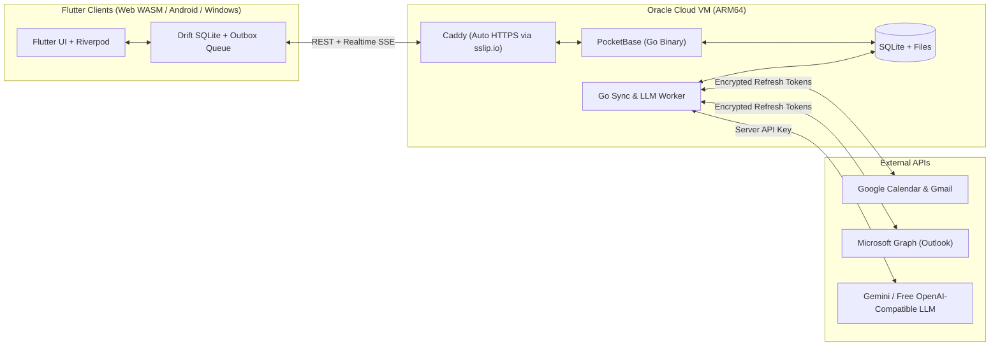

# Tasker Implementation Plan: OCI PocketBase + Drift Offline Sync + Live Integrations

> **Status**: Implemented in open PR #1 (`feat/production-pocketbase-sync`: https://github.com/KidOBricks/tasker/pull/1).

## Locked-In Architecture & Design Decisions

| Area | Decision |
| :--- | :--- |
| **Backend & Hosting** | Single custom **PocketBase (Go)** binary behind **Caddy** on an Oracle Cloud Always Free (Ampere ARM64) VM, with daily backups to OCI Object Storage |
| **Domain & TLS** | Zero-signup **`sslip.io`** hostname (`https://<ip-with-dashes>.sslip.io`, or optional custom domain) with Caddy automatic Let's Encrypt HTTPS |
| **Authentication** | Email/password + Google & Microsoft OAuth2 SSO; **admin-created / invited users only** (no open self-signup) |
| **Email & Recovery** | No automated SMTP/email; rely on Google/Microsoft SSO and manual admin password resets in PocketBase `/_/` |
| **External Integrations** | Server-side OAuth2 code exchange, encrypted refresh tokens, and scheduled/on-demand syncing in Go for **read-only Google Calendar**, **read-only Outlook Calendar**, and **Gmail** (two-way calendar write-back deferred to Phase 2) |
| **AI Task Extraction** | Server-side **pluggable LLM interface** (Gemini + free OpenAI-compatible provider swap via env config + heuristic regex fallback) |
| **Client Sync & Storage** | **Flutter + Drift (SQLite)** local database across Web (WASM), Android, and Windows with a dirty outbox queue, `updatedAt` Last-Write-Wins, PocketBase Realtime SSE, and PocketBase file storage for attachments |
| **Admin Portal** | **PocketBase `/_/` Admin UI exclusively**; remove mocked `web/admin.html` and `AdminConsoleScreen` |
| **Platforms & CI/CD** | **Web** (served from OCI), **Android APK**, and **Windows desktop** built and tested in GitHub Actions |

---

## System Architecture

---

## Phase 1: OCI Infrastructure, Domain & PocketBase Server Scaffolding

### 1.1 Oracle Cloud VM & Reverse Proxy Setup
- Provision an **OCI Ampere A1 (ARM64)** instance running Ubuntu 22.04/24.04 (recommend Pay-As-You-Go upgrade within Always Free limits to avoid capacity blocks and 7-day idle reclamation).
- Configure OCI Security List / `ufw` to allow inbound `80/tcp`, `443/tcp`, and `22/tcp` (key-only SSH).
- Use `sslip.io` (`<ip-with-dashes>.sslip.io`) or a custom domain pointing to the OCI VM's public IP.
- Configure **Caddy** as reverse proxy:
  - Route `/_/*` and `/api/*` -> PocketBase (`127.0.0.1:8090`).
  - Route `/` -> built Flutter Web bundle (`pb_public/` or static directory with SPA fallback).
- Configure automated daily SQLite backup (PocketBase built-in S3 backup to **OCI Object Storage** S3-compatible bucket).

### 1.2 Go PocketBase Project (`backend/`)
Go module embedding PocketBase (`github.com/pocketbase/pocketbase`):
- **Collections & Schema** (idempotent Go migrations):
  - `users` (PocketBase auth collection): `displayName`, `role` (`user`/`admin`), `isActive` (`bool`), `preferences`. Public create rule disabled so only admins can create/invite users.
  - `user_profiles`: per-user settings from `lib/domain/models/user_profile.dart` (excluding raw `geminiApiKey` since extraction is server-side), `updatedAt`.
  - `categories`: `user` relation, `name`, `colorValue`, `iconName`, `sortOrder`, `updatedAt`, `deletedAt`.
  - `recurrence_rules`: mirrors `lib/domain/models/recurrence_rule.dart` + `user` relation, `updatedAt`, `deletedAt`.
  - `tasks`: mirrors `lib/domain/models/task_item.dart` + `user` relation, PocketBase `attachments` (file field replacing local `attachmentPaths`), `updatedAt`, `deletedAt` (soft delete for cross-device sync).
  - `oauth_connections` (**hidden from client read rules / server-only**): `user` relation, `provider` (`google` | `microsoft`), `accountEmail`, `encryptedAccessToken`, `encryptedRefreshToken`, `expiresAt`, `scopes`.
  - `external_events`: synced calendar events per `user` (`provider`, `externalId`, `title`, `startTime`, `endTime`, `location`, `meetingUrl`, `hasLinkedTask`, `updatedAt`).
  - `task_suggestions`: AI-extracted email action items per `user` (`emailId`, `sender`, `subject`, `snippet`, `title`, `description`, `categoryId`, `importance`, `suggestedDueDate`, `status`: `pending` | `accepted` | `dismissed`).
- **API Rules**: Enforce `@request.auth.id != "" && user = @request.auth.id` on every user-owned collection; block client access to `oauth_connections`.

---

## Phase 2: Real OAuth2 Flows, Calendar/Gmail Sync & Pluggable LLM

### 2.1 Google & Microsoft OAuth2 Consent Setup
- **Google Cloud Console**: Enable **Google Calendar API** and **Gmail API**; configure OAuth consent screen (`Testing` mode with users added as Test Users, or `Internal` if Workspace) with `calendar.readonly`, `gmail.readonly`, `openid`, `email`, `profile`; register `https://<host>/api/integrations/google/callback`.
- **Microsoft Entra ID**: Register app with `Calendars.Read`, `offline_access`, `User.Read`; register `https://<host>/api/integrations/microsoft/callback`.

### 2.2 Go Integration Endpoints & Sync Worker
- **Encryption helper**: Encrypt/decrypt OAuth refresh tokens with AES-256-GCM using `TOKEN_ENCRYPTION_KEY` env var on the OCI VM.
- **Custom PocketBase Routes**:
  - `GET /api/integrations/{provider}/connect`: Generates PKCE/state OAuth URL (`access_type=offline&prompt=consent` for Google, `offline_access` for Microsoft) and redirects; works from Web, Android (`tasker://oauth-callback` deep link), and Windows.
  - `GET /api/integrations/{provider}/callback`: Exchanges code for tokens, encrypts and stores in `oauth_connections`, triggers initial sync, redirects back to client.
  - `GET /api/integrations/status` & `DELETE /api/integrations/{provider}`: Returns connected email/last-synced status without exposing tokens.
  - `POST /api/integrations/sync`: On-demand Calendar + Gmail sync trigger for the authenticated user.
- **Scheduled Go Cron (`pb.Cron()`)**:
  - Every 15 minutes, refresh expired access tokens, pull upcoming Google & Outlook events into `external_events`, and scan unread Gmail messages to populate `task_suggestions` (deduplicated by `emailId`).
- **Pluggable LLM Extractor (`ExtractorProvider` Go interface)**:
  - Env-configured (`LLM_PROVIDER=gemini|openai_compat|heuristic`, `LLM_API_KEY`, `LLM_BASE_URL`, `LLM_MODEL`).
  - Supports **Gemini**, **any OpenAI-compatible endpoint**, and **heuristic keyword fallback**.

---

## Phase 3: Flutter Client — Drift Offline Sync & PocketBase Integration

### 3.1 Dependencies & Platform Setup
- Uses `pocketbase`, `drift`, `sqlite3_flutter_libs`, `path`, `url_launcher`, `app_links` (Android/Windows OAuth deep links), and dev dependencies `drift_dev`, `build_runner`.
- Bundles `sqlite3.wasm` and `drift_worker.js` in `web/` for Drift on Web.

### 3.2 Drift Local Database & Sync Engine
- Replaces single-key `SharedPreferences` persistence in `TaskRepository` with a **Drift** database (`lib/data/local/app_database.dart`):
  - Tables: `local_tasks`, `local_categories`, `local_recurrence_rules`, `local_profile`, `local_external_events`, `local_suggestions`, plus `sync_outbox`.
  - Every local table includes `userId` for multi-tenant isolation.
- `DatabaseService` acts as a real **SyncEngine**:
  1. **Push**: Flush `sync_outbox` to PocketBase REST API (uploading pending attachment files first).
  2. **Pull**: Fetch records modified since `lastSyncedAt` per user and merge into Drift using **Last-Write-Wins (`updatedAt`)** + soft-delete (`deletedAt`) propagation.
  3. **Realtime**: Subscribe to PocketBase SSE while online.

### 3.3 Auth, Integrations & Admin Cleanup
- Invite-only `AuthScreen` (email/password via `authWithPassword` + Google/Microsoft SSO via `authWithOAuth2`, Server URL configuration).
- Integrations UI wired to `/api/integrations/{provider}/connect` and `POST /api/integrations/sync`.
- Removed mocked `web/admin.html` and `AdminConsoleScreen` in favor of PocketBase `/_/`.

---

## Phase 4: Testing & GitHub Actions CI/CD
- **Backend Tests (`go test ./...`)**: Token encryption, OAuth state validation, `ExtractorProvider`, and deduplication.
- **Flutter Tests (`flutter test`)**: Domain logic, Drift offline queuing & conflict resolution, and widget walkthroughs.
- **GitHub Actions (`.github/workflows/ci.yml`)**: `backend-test`, `flutter-verify`, and release builds for Web, Android APK, and Windows desktop.
